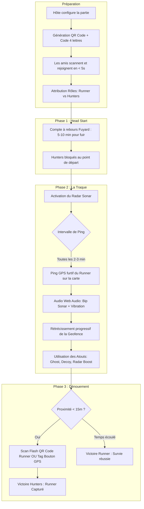

# Étude d'Architecture & Game Design : Manhunt IRL (Web Mobile / PWA)

> **Document de Référence & Spécifications Techniques**  
> **Type de projet :** Web Application Mobile / PWA temps réel  
> **Concept :** Chasse à l'homme dans la vraie vie (IRL) guidée par radar GPS tactique sur smartphone.

---

## 1. Vision Globale & Philosophie du Jeu

### 1.1 L'Essence du Manhunt IRL
Le Manhunt IRL transforme l'espace urbain ou naturel (quartier, campus, parc, ville) en une arène de jeu dynamique. L'adrénaline repose sur **l'asymétrie de l'information**, le **bluff**, et la **gestion du timing**.

### 1.2 Les 3 Écueils Majeurs à Éviter
1. **Le tracking GPS continu (en temps réel pur)** : Afficher la position exacte en direct du fuyard tue tout le plaisir du jeu en 3 minutes. Le fuyard ne peut ni se cacher, ni feinter, et les traqueurs se contentent de fixer une flèche sans regarder leur environnement réel.
2. **Les litiges de capture ("Je t'ai touché !", "Non t'étais trop loin !")** : Sans mécanisme objectif et incontestable de capture, le jeu dégénère en contestation verbale ou en course effrénée dangereuse (risques de collision ou chute).
3. **La friction d'installation et de batterie** : Forcer les amis à télécharger une application native sur l'App Store / Google Play avec création de compte et mot de passe fait fuir 70% des joueurs. De même, une application qui vide la batterie en 20 minutes ou coupe l'écran en veille détruit la partie.

---

## 2. Game Design & Mécaniques Clés



### 2.1 Rôles & Asymétrie
* **Le Runner (Fuyard / Cible)** :
  * 1 joueur (ou un binôme pour les grands groupes).
  * *Objectif* : Survivre jusqu'à la fin du chrono (ex: 30 à 45 minutes) ou atteindre un point d'extraction défini.
  * *Affichage HUD* : Carte avec périmètre de jeu, compte à rebours, indicateur du "Prochain Ping dans X secondes", boutons d'atouts d'urgence (Ghost, Decoy), et QR Code de capture affiché.
* **Les Hunters (Traqueurs / Chasseurs)** :
  * Équipe de 2 à 10+ joueurs.
  * *Objectif* : Localiser, encercler et capturer le Runner avant la fin du temps imparti.
  * *Affichage HUD* : Carte collective avec position en direct de leurs coéquipiers (pour faciliter l'encerclement tactique), dernier ping connu du Runner (avec cercle d'incertitude et historique d'empreinte), jauge de sonar et bouton de Tag de capture.

### 2.2 Le Système de Ping / Radar Sonar
Le Ping est le cœur de tension du jeu :
* **Cadence dynamique** :
  * Début de partie : Ping toutes les **2 à 3 minutes**.
  * Milieu de partie : Ping toutes les **90 secondes**.
  * Final (5 dernières minutes) : Ping toutes les **30 à 45 secondes** (effet "panique finale").
* **Le "Fog of War" / Rayon d'incertitude** :
  * Au lieu d'afficher une épingle GPS chirurgicale, le Ping affiche un **cercle de probabilité de 30 à 50 mètres** teinté en rouge/orange pulsant avec l'heure exacte du relevé (ex: *« Vu il y a 45s »*).
  * Cela permet au fuyard de faire du bluff (ex: sprinter vers une ruelle, attendre le ping, puis repartir discrètement dans l'autre sens pendant le cooldown du ping).
* **Feedback Sensoriel immersif** :
  * 5 secondes avant le ping : compte à rebours audio discret (*bips d'armement*).
  * Au moment du ping : **Bip Sonar de sous-marin caractéristique** diffusé sur les smartphones des chasseurs et du fuyard + **vibration haptique double**.
  * Son modulé en fréquence : si un chasseur est à moins de 50m au moment du ping, le pitch du bip est plus aigu et rapide.

### 2.3 Avance Initiale (Head Start)
* Au lancement du jeu, le Runner dispose d'une avance (ex: **5 à 10 minutes** paramétrable).
* Durant cette phase :
  * L'écran des Hunters affiche un compte à rebours de déblocage avec une carte masquée ou verrouillée sur leur position.
  * Le Runner a le champ libre pour se fondre dans la zone et préparer son itinéraire de fuite.

### 2.4 Zones de Jeu (Geofencing & Dynamic Shrinking Zone)
* **Définition de l'arène** :
  * L'hôte sélectionne un point central et un rayon (ex: 800m, 1.5km, ou dessin d'un périmètre).
* **Rétrécissement dynamique (type Battle Royale)** :
  * Pour forcer l'affrontement et éviter que le fuyard n'attende passivement au bout du monde, la zone se rétrécit toutes les 10 minutes.
* **Avertissement & Sanctions hors-zone** :
  * Si un joueur franchit la bordure :
    * Alerte rouge immédiate + vibration continue : *"ATTENTION : Vous êtes hors zone ! Retournez-y dans 30 secondes !"*.
    * Si le Runner reste hors zone : sa **position GPS exacte est diffusée en direct permanent** aux chasseurs jusqu'à son retour dans la zone légale.

### 2.5 Pouvoirs & Atouts Tactiques (Gameplay Cards)

| Atout | Rôle | Effet | Cooldown / Usage |
| :--- | :--- | :--- | :--- |
| **Ghost Mode** | Runner | Annule le prochain Ping programmé (les chasseurs reçoivent *« Signal Perdu »*). | 1 ou 2 utilisations max par partie |
| **Decoy (Leurre)** | Runner | Envoie un faux ping GPS aléatoire à 150m de sa vraie position pour disperser la meute. | 1 utilisation par partie |
| **Hunter Jammer** | Runner | Brouille l'écran des chasseurs (neige/statique visuel) pendant 45 secondes. | Rechargeable via marche (ex: 500m parcourus) |
| **Sonar Overdrive** | Hunters | Déclenche un ping forcé instantané sans attendre la fin du chrono régulier. | 1 utilisation partagée par l'équipe des chasseurs |
| **Triangulation** | Hunters | Trace un vecteur d'angle si 2 chasseurs scannent simultanément, réduisant le rayon d'incertitude à 10m. | Cooldown de 8 minutes |

### 2.6 Validation de Capture : Zéro Contestation
Pour éviter toute ambiguïté sur la capture :
1. **Mécanique Principale : Le Flash QR Code Runner (Incontestable)** :
   * Le smartphone du Runner affiche un QR Code dynamique de capture en gros contraste.
   * Pour valider la capture, un Hunter doit s'approcher physiquement (distance de contact visuel ~1 à 2 mètres) et **scanner le QR Code avec l'interface scanner intégrée** de sa PWA.
   * La validation est instantanée, vérifiée par le serveur WebSocket, et déclenche l'animation de fin de partie avec son de victoire/défaite.
2. **Mécanique Alternative : Tag de Proximité GPS + Confirmation** :
   * Un bouton "TAGGUER LE FUYARD" devient cliquable pour un chasseur uniquement si la distance GPS calculée côté serveur est `< 12 mètres`.
   * Dès qu'il appuie, le fuyard reçoit une alerte plein écran : *"Vous avez été taggué par [Nom Chasseur]. Confirmer la capture ?"* (avec compte à rebours auto-validé en 15 secondes en l'absence de contestation).

---

## 3. Faisabilité Technique sur Navigateurs Mobiles (iOS Safari & Android Chrome)

### 3.1 Géolocalisation Mobile (`navigator.geolocation`)
* **API utilisée** : `navigator.geolocation.watchPosition(success, error, options)`.
* **Options optimales** :
  ```javascript
  {
    enableHighAccuracy: true, // Active le GPS hardware (indispensable)
    timeout: 8000,            // Rejette les relevés trop lents
    maximumAge: 1000          // Données fraîches (< 1s)
  }
  ```
* **Contrainte critique : Le Background Throttling sur Mobile** :
  * Dès que l'écran s'éteint ou que Safari/Chrome passe en arrière-plan, les timers JS (`setInterval`) sont bridés à 1 exécution par minute ou suspendus, et les relevés GPS s'arrêtent pour économiser la batterie.
* **Solutions et Parades Techniques** :
  1. **Screen WakeLock API** :
     ```javascript
     if ('wakeLock' in navigator) {
       let wakeLock = await navigator.wakeLock.request('screen');
     }
     ```
     Empêche l'écran du smartphone de s'éteindre tout au long de la traque !
  2. **Thème "OLED Pure Black" (#000000)** :
     En mode Dark OLED, les pixels noirs des écrans OLED récents (iPhone et Galaxy) sont physiquement éteints, ce qui réduit drastiquement la consommation électrique même écran allumé.
  3. **PWA Standalone (Mode plein écran)** :
     Installable en 1 tap via *"Ajouter à l'écran d'accueil"* (ou via un bandeau explicatif prompt). En mode standalone, Safari iOS et Chrome allouent plus de ressources continues et évitent les fermetures intempestives d'onglets.
  4. **Filtre de Kalman / Lissage GPS** :
     En milieu urbain, les rebonds d'ondes satellites sur les façades provoquent des "sauts" de 15-20 mètres. Un micro-filtre de lissage (moyenne exponentielle mobile sur les 3 derniers points avec `accuracy < 25m`) stabilise le marqueur sur la carte.

### 3.2 Cartographie Mobile : Leaflet vs Mapbox GL
* **Pourquoi Leaflet.js est le choix roi ici** :
  * **Poids plume** : Leaflet pèse seulement ~42 Ko (contre plus de 500 Ko pour Mapbox GL / MapLibre).
  * **Consommation CPU/GPU nulle** : Leaflet utilise des tuiles raster 2D légères et du DOM/Canvas simple, là où Mapbox WebGL fait chauffer les téléphones et draine la batterie en plein soleil.
  * **Fluidité 60 fps sur smartphones modestes**.
* **Tuiles Cartographiques Recommandées** :
  * **CartoDB Dark Matter** (`https://{s}.basemaps.cartocdn.com/dark_all/{z}/{x}/{y}{r}.png`) :
    * Esthétique tactique sombre / cyberpunk parfaite pour un radar.
    * Gratuite, rapide, sans clé d'API obligatoire pour un usage raisonnable.
    * Met en valeur les marqueurs lumineux (points néon orange pour les chasseurs, cercle rouge pour le ping).

### 3.3 Communication Temps Réel Ultra-Réactive
* **Technologie recommandée** :
  * **WebSockets natifs** avec reconnexion automatique (via **Socket.io** ou **Fastify WebSocket** ou **PartyKit / Cloudflare Durable Objects**).
* **Architecture par Game Rooms** :
  * Chaque partie est une "Room" isolée en mémoire identifiée par son code (ex: `WOLF`).
  * Latence constatée : **< 30 à 60 ms** sur réseau 4G/5G.
* **Payload binaire ou JSON ultra-compact** :
  ```json
  // Client -> Serveur (Émission GPS toutes les 2-3s pour les chasseurs, au ping pour le fuyard)
  { "t": "pos", "x": 48.85661, "y": 2.35222, "a": 12, "h": 180 }
  ```
* **Résilience Réseau (Tunnel 4G / Zones d'ombre)** :
  * Système de heartbeat (ping-pong toutes les 5s).
  * En cas de coupure : reconnexion automatique en arrière-plan sans rafraîchir la page ni perdre la session.
  * HUD affiche une icône discrète : *"Signal GPS excellent (±5m)"* ou *"Recherche satellite..."*.

### 3.4 Audio & Haptique (Immergé sans assets lourds)
* **Web Audio API (Génération Procédurale de Bips Sonar)** :
  * Zéro fichier MP3 ou WAV à télécharger (zéro temps de chargement, fonctionne hors-ligne).
  * Génération directe par synthèse d'ondes :
    ```javascript
    function playSonarPing(frequency = 900, duration = 0.6) {
      const audioCtx = new (window.AudioContext || window.webkitAudioContext)();
      const osc = audioCtx.createOscillator();
      const gain = audioCtx.createGain();
      osc.type = 'sine';
      osc.frequency.setValueAtTime(frequency, audioCtx.currentTime);
      osc.frequency.exponentialRampToValueAtTime(300, audioCtx.currentTime + duration);
      gain.gain.setValueAtTime(0.8, audioCtx.currentTime);
      gain.gain.exponentialRampToValueAtTime(0.01, audioCtx.currentTime + duration);
      osc.connect(gain);
      gain.connect(audioCtx.destination);
      osc.start();
      osc.stop(audioCtx.currentTime + duration);
    }
    ```
  * *Important iOS* : L'`AudioContext` doit être initialisé/débloqué lors du premier tap utilisateur ("Rejoindre la partie").
* **Vibration Haptique** :
  * Android Chrome : `navigator.vibrate([150, 80, 150])` pour l'alerte radar.
  * iOS Safari : `navigator.vibrate` n'est pas supporté par Apple dans WebKit. Fallback via retour sonore basse fréquence ("sub-thump" à 80Hz) ou micro-animations UI haptiques à l'écran.

---

## 4. Recommandations d'Architecture & UX "Onboarding en 5 Secondes"

### 4.1 Parcours Utilisateur Zéro Friction
```
[Créateur de la partie]                  [Ami invité]
      │                                       │
1. Ouvre manhunt.party                        │
2. Configure (30m, 1.5km, 2m ping)            │
3. Écran "Lobby" affiche un QR géant          │
   + Code 4 lettres (ex: LION)                │
      │                                       │
      │◄────── Scanne le QR Code ─────────────┤ (avec l'appareil photo du smartphone)
      │        (ou tape manhunt.party/LION)   │
      │                                       │
      │                                 1. Arrive directement sur /join/LION
      │                                 2. Tape son prénom ("Lucas")
      │                                 3. Clique sur "Prêt !"
      │                                 4. Validation GPS (1 tap)
      │                                       │
      ▼                                       ▼
  [Démarrage instantané de la partie : 5 secondes chrono !]
```

### 4.2 Points Forts de l'Approche Zéro Friction :
* **Aucun compte ni mot de passe** : Une session temporaire basée sur un `client_id` (UUID généré stocké dans le `sessionStorage`).
* **Code de partie mémorisable** : 4 lettres majuscules simples (pas de chiffres ambigus `0/O` ou `1/I`), ex: `WOLF`, `HAWK`, `BEAR`, `LION`.
* **Deep Link URL direct** : Le scan du QR code contient déjà le code dans l'URL (`https://app.domaine/play?code=WOLF`). L'invité n'a même pas à taper les 4 lettres.
* **Auto-reconnexion** : Si le joueur rafraîchit son navigateur par erreur, son UUID local le reconnecte immédiatement à son rôle et à sa partie en cours sans interruption.

---

## 5. Spécifications de la Stack Technique Recommandée

### 5.1 Architecture Globale du Système

```mermaid
graph LR
    subgraph Client [Mobile PWA (iOS / Android)]
        UI[Tailwind CSS + Lucide Icons]
        Map[Leaflet + CartoDB Dark Tiles]
        Audio[Web Audio API Sonar Synth]
        GPS[Geolocation Watcher + WakeLock]
        State[Zustand Game Store]
        ClientSocket[Socket.io / WebSocket Client]
    end

    subgraph Backend [Serveur Temps Réel Node.js / Edge]
        Gateway[Fastify HTTP + WebSocket / Socket.io]
        RoomManager[In-Memory Room State Manager]
        GeofenceEngine[Calculs Haversine & Geofencing]
        PingScheduler[Planificateur de Pings & Cooldowns]
    end

    ClientSocket <==>|Événements WebSocket| Gateway
    Gateway --> RoomManager
    RoomManager --> GeofenceEngine
    RoomManager --> PingScheduler
```

### 5.2 Détail des Composants Recommandés

1. **Frontend Mobile (PWA)** :
   * **Framework** : **Vite + React (TypeScript)** ou **Next.js 15 (App Router)**. *Vite + React PWA est particulièrement agile pour une SPA mobile ultra-rapide sans latence de serveur.*
   * **Style & Design System** : **Tailwind CSS v4** avec une palette *Tactical Dark* :
     * Arrière-plan : Noir pur `#0a0a0c`
     * Accent Chasseur : Cyan néon `#00f0ff` ou Ambre tactique `#ffb703`
     * Accent Fuyard : Rouge alerte néon `#ff0055`
     * Typographie : Font monospace technique (ex: `JetBrains Mono` ou `Geist Mono`) pour les compteurs et coordonnées.
   * **Cartographie** : `leaflet` + `@types/leaflet` + `react-leaflet` (ou Leaflet vanilla instancié dans un `useEffect` pour un contrôle maximal des performances).
   * **State Management** : `zustand` (stockage réactif et ultra-léger de l'état du lobby, positions des joueurs, cooldowns et audio).
   * **Scanner QR Code** : `@zxing/browser` ou `html5-qrcode` (très légers, accès caméra instantané sans librairie native).

2. **Backend Temps Réel & Logique de Jeu** :
   * **Moteur WebSocket** : **Fastify** avec `@fastify/websocket` ou **Socket.io 4.x**.
   * **Gestion de l'état en mémoire (In-Memory)** :
     * Les parties de Manhunt sont éphémères (durent 30-60 min).
     * Aucune base de données SQL lourde n'est requise pour le gameplay actif ! Toutes les Rooms et positions sont maintenues en RAM via une structure `Map<RoomCode, GameSession>`.
     * Une persistance optionnelle (Redis ou SQLite léger) peut simplement logguer les scores finaux si nécessaire.
   * **Calculs Géospatiaux ultra-rapides** :
     * Formule de **Haversine** pour calculer la distance métrique entre deux coordonnées GPS en quelques microsecondes sans dépendance SIG lourde.
     * Détection point dans un cercle (Geofence) : `distance(player, center) <= radius`.

---

## 6. Synthèse & Prochaines Étapes pour le Projet

| Dimension | Choix Préconisé | Justification Clé |
| :--- | :--- | :--- |
| **Plateforme** | PWA Web Mobile (Safari & Chrome) | Onboarding immédiat sans téléchargement sur App Store / Google Play. |
| **Cartographie** | Leaflet + CartoDB Dark Matter | Ultra-léger (<50 Ko), économe en batterie, esthétique radar sombre. |
| **Temps Réel** | WebSockets (Socket.io / Fastify) | Latence < 50ms, rooms isolées par code à 4 lettres. |
| **Capture IRL** | Double validation : QR Code + Rayon GPS < 15m | Incontestable, ludique, évite les plaquages et litiges. |
| **Autonomie Batterie** | Screen WakeLock + Thème OLED Noir Pur | Écran actif en continu sans mise en veille brutale. |
| **Audio** | Synthèse procédurale Web Audio API | Bips radar immersifs sans téléchargement de fichiers audio. |

Cette étude fournit le socle complet d'architecture technique et de game design, prêt à être décliné en maquettes d'interface et en plan d'implémentation itératif.
